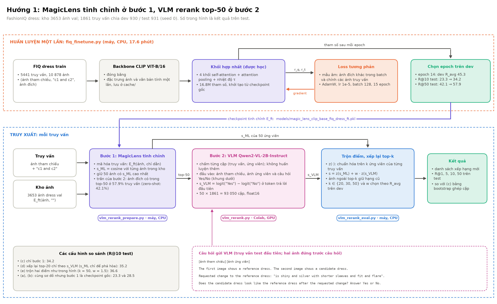
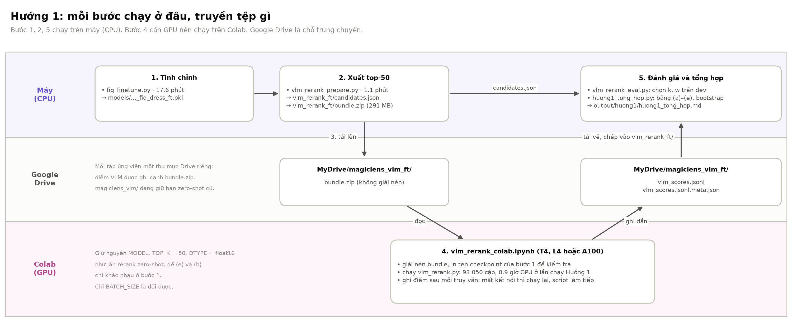

# Hướng 1: ghép tinh chỉnh với rerank bằng VLM

Hai cải tiến tốt nhất của dự án trên FashionIQ dress chưa từng được chạy cùng nhau:

- **Tinh chỉnh khối hợp nhất của MagicLens:** R@10 trên test tăng từ 23.3 lên 34.2.
- **Rerank top-50 bằng VLM Qwen2-VL-2B:** R@10 tăng từ 23.3 lên 28.5.

Hướng 1 dùng mô hình đã tinh chỉnh làm bước 1 để lấy top-50, rồi rerank top-50 đó bằng đúng pipeline VLM cũ. Câu hỏi cần trả lời: rerank còn giúp được bao nhiêu khi bước 1 đã mạnh hơn. Tinh chỉnh nâng R@50 từ 42.1 lên 57.9, tức là nâng trần cho rerank, nhưng tập ứng viên cũng khó phân biệt hơn.

Đây là mục 4 của tài liệu đề xuất cải tiến (`DeXuat_CaiTien_MagicLens.docx`).

**Kết quả (chạy xong ngày 16/11/2026):**
- **Cấu hình tốt nhất là (e):** R@10 đạt 36.6 trên test.
- **Rerank vẫn có ích khi bước 1 đã tinh chỉnh:** +2.5 [+0.5, +4.4] điểm. Mức tăng này chỉ bằng khoảng một nửa mức tăng khi bước 1 là zero-shot.

Chi tiết ở mục 5.



Phần trên của hình là bước tinh chỉnh, chỉ chạy một lần. Phần dưới là đường đi của một truy vấn qua hai bước. Hình được vẽ bằng [`src/ve_so_do.py`](src/ve_so_do.py), cùng script với các hình trong [kien_truc_pipeline.md](kien_truc_pipeline.md).

## 1. Năm cấu hình so sánh

Mọi cấu hình dùng cùng kho ảnh (3653 ảnh của tập val dress), cùng 1861 truy vấn và cùng cách chia dev 930 / test 931 (seed 0). Số trong bảng là R@10 trên test.

| Ký hiệu | Bước 1 | Rerank | R@10 test |
|---|---|---|---|
| (a) | MagicLens zero-shot | Không | 23.3 |
| (b) | MagicLens zero-shot | MagicLens + VLM | 28.5 |
| (c) | MagicLens tinh chỉnh | Không | 34.2 |
| (d) | MagicLens tinh chỉnh | Chỉ VLM | 35.2 (Hướng 1) |
| (e) | MagicLens tinh chỉnh | MagicLens + VLM | **36.6** (Hướng 1) |

## 2. Những gì có trong repo

Các script được chuyển từ dự án cũ (repo `MagicLen`) sang repo này:

| Tệp | Việc làm |
|---|---|
| `fiq_experiments.py` | Các thủ thuật không cần huấn luyện; tạo cache đặc trưng CLIP mà mọi script khác dùng |
| `fiq_finetune.py` | Tinh chỉnh khối hợp nhất; giờ lưu cả checkpoint đã tinh chỉnh |
| `vlm_rerank_prepare.py` | Xuất top-50 của một checkpoint và đóng gói ảnh thành `bundle.zip` |
| `vlm_rerank.py` | Chấm từng cặp (truy vấn, ứng viên) bằng VLM; chạy trên Colab, nằm sẵn trong `bundle.zip` |
| `vlm_rerank_colab.ipynb` | Notebook Colab chạy `vlm_rerank.py` |
| `vlm_rerank_eval.py` | Trộn điểm MagicLens với điểm VLM, chọn k và w trên dev, báo cáo trên test |
| `huong1_tong_hop.py` | **Mới:** dựng bảng (a)–(e) và các phép so sánh của Hướng 1 |
| `download_fiq_images.py` | Tải ảnh FashionIQ từ đường dẫn Amazon gốc (cách dự án cũ đã lấy dữ liệu) |

`data_utils.py`, `model.py` và `inference.py` cũng được thay bằng bản của dự án cũ. Các bản này thêm ba thứ vào mã gốc:
- **Chế độ tiền xử lý ảnh** `crop` và `pad`; mặc định vẫn là cách gốc.
- **Bỏ ảnh và truy vấn bị thiếu** khi đọc FashionIQ.
- **Các hàm** `encode_image`, `encode_text`, `fuse`, để chỉ phải chạy lại phần hợp nhất.

Những thứ sau chỉ có trên máy, không được đưa lên GitHub (xem `.gitignore`). Chúng được chép từ thư mục BTL của dự án cũ:

| Thư mục | Nội dung |
|---|---|
| `.venv/` | Môi trường Python đã kiểm thử: jax 0.11.1, flax 0.12.9, optax 0.2.8 |
| `data/fiq/` | Bộ FashionIQ cũ: các ảnh còn tải được từ Amazon, gồm 3653 ảnh kho val và 5441 truy vấn train của dress |
| `cache/fiq-dress-base/` | Đặc trưng CLIP đã tính sẵn cho tập val và train |
| `models/` | Checkpoint MagicLens-base gốc, và checkpoint tinh chỉnh do bước 1 tạo ra |

Kết quả cũ cần cho so sánh thì được đưa lên GitHub:
- `output/`: bảng kết quả của các thí nghiệm cũ.
- `vlm_rerank/`: ứng viên và điểm VLM của lần rerank zero-shot.

Luôn chạy script bằng `.venv/bin/python`, từ thư mục gốc của repo.

## 3. Các bước



### Bước 1. Tinh chỉnh và lưu checkpoint (máy, khoảng 15–20 phút)

```bash
.venv/bin/python fiq_finetune.py --subtask dress --lrs 1e-5 --output ./output/huong1
```

Lệnh này chỉ chạy lại tốc độ học đã được chọn (1e-5). Thứ tự dữ liệu được sinh lại từ seed 0, nên lần chạy đi đúng quỹ đạo cũ. Script lưu tham số của epoch có dev R_avg cao nhất vào `models/magic_lens_clip_base_fiq_dress_ft.pkl`. Sau khi lưu, script nạp lại tệp này đúng như `inference.py` vẫn làm, và kiểm tra tệp cho ra cùng thứ hạng. Bảng kết quả ghi vào `output/huong1/fiq-dress-base_finetune.md`. Thư mục `output/huong1/` riêng giữ cho bảng cũ (có cả ba tốc độ học) không bị ghi đè.

**Đã chạy trên máy này** (17.6 phút trên CPU):
- **Đường học:** trùng từng epoch với lần chạy cũ; epoch 14 cho dev R_avg cao nhất, 45.3.
- **Trên test:** R@10 34.2, R@50 57.9, R_avg 46.0. So với zero-shot, R@10 tăng +10.8 [+8.3, +13.3] điểm.
- **Checkpoint:** `models/magic_lens_clip_base_fiq_dress_ft.pkl` (666 MB).

### Bước 2. Xuất top-50 của mô hình tinh chỉnh (máy, khoảng 1 phút)

Script dùng lại đặc trưng CLIP trong cache. Trước khi dùng, nó kiểm tra cache được tạo bằng đúng backbone của checkpoint này. Bước 1 giữ backbone đóng băng nên phép kiểm tra phải qua.

```bash
.venv/bin/python vlm_rerank_prepare.py --subtask dress \
    --model_path ./models/magic_lens_clip_base_fiq_dress_ft.pkl --out_dir ./vlm_rerank_ft
```

Tạo `vlm_rerank_ft/candidates.json` và `vlm_rerank_ft/bundle.zip`. Tệp zip gồm danh sách ứng viên, `vlm_rerank.py` và các ảnh cần dùng. Phải dùng thư mục `vlm_rerank_ft/` riêng: `vlm_rerank/` đang giữ ứng viên zero-shot ứng với điểm VLM cũ. Script sẽ từ chối ghi đè nếu bạn quên `--out_dir`.

**Đã chạy trên máy này** (1.1 phút):
- **Bước 1 tinh chỉnh trên test:** R@10 34.2, R@50 57.9. Ảnh đích nằm trong top-50 ở 57.9% truy vấn test, so với 42.1% khi bước 1 là zero-shot.
- **`bundle.zip`:** 291 MB, gồm 3650 ảnh.

R@1 trên test của bước 1 ở đây là 11.4, còn bảng của bước 1 ghi 11.5. Nguyên nhân: bước 1 nhân ma trận bằng JAX, bước 2 bằng NumPy, nên điểm lệch nhau tối đa 6 × 10⁻⁷ do làm tròn. Ở một truy vấn test, ảnh đích và một ảnh khác có điểm chỉ chênh 1.2 × 10⁻⁷, nên hai ảnh đổi chỗ. R@5, R@10, R@50 không đổi. Mọi so sánh của Hướng 1 đều dùng thứ hạng của bước 2, nên vẫn nhất quán với nhau.

### Bước 3. Tải lên Google Drive

1. Mở [drive.google.com](https://drive.google.com). Trong **My Drive**, tạo thư mục mới tên **`magiclens_vlm_ft`**.
2. Tải `vlm_rerank_ft/bundle.zip` vào thư mục đó. **Không giải nén.**

Đừng đặt vào thư mục `magiclens_vlm` cũ. Mỗi tập ứng viên cần một thư mục riêng trên Drive, vì điểm VLM được ghi cạnh `bundle.zip`.

### Bước 4. Chấm điểm bằng VLM trên Colab

1. Vào [colab.research.google.com](https://colab.research.google.com), chọn **File → Upload notebook**, rồi chọn `vlm_rerank_colab.ipynb` trong repo.
2. Vào **Runtime → Change runtime type**, chọn GPU. T4, L4 hay A100 đều chạy được; L4 là lựa chọn vừa phải về tốc độ và chi phí.
3. Chạy lần lượt ô 1 đến ô 5:
   - **Ô 3:** đã đặt sẵn `DRIVE_DIR = ".../MyDrive/magiclens_vlm_ft"`.
   - **Ô 5:** sau khi giải nén, ô này in ra "Ứng viên của bước 1: magic_lens_clip_base_fiq_dress_ft.pkl". Nếu dòng này in ra tên khác, bạn đã tải nhầm bundle.
4. **Ô 6** chạy thử 3 truy vấn và phải in ra **OK**. Lần đầu, ô này tải Qwen2-VL-2B (khoảng 4.5 GB).
5. **Ô 7** chạy đầy đủ 1861 truy vấn × 50 ứng viên (93 050 cặp). Lần rerank zero-shot trên T4 mất 2.3 giờ; lần chạy Hướng 1 mất 0.9 giờ. Nếu bị ngắt kết nối, chạy lại ô 1–5 rồi ô 7; script chạy tiếp từ chỗ dừng.
6. **Ô 8** báo XONG khi đủ 1861 truy vấn. **Ô 9** tải về hai tệp: `vlm_scores.jsonl` và `vlm_scores.jsonl.meta.json`.

Giữ nguyên `MODEL`, `TOP_K = 50` và `DTYPE = "float16"` như lần rerank zero-shot. Như vậy khác biệt duy nhất giữa (e) và (b) là mô hình ở bước 1. Chỉ `BATCH_SIZE` là đổi được; trên L4 hoặc A100 có thể tăng lên 32 cho nhanh hơn.

### Bước 5. Đánh giá và tổng hợp (máy, vài giây)

Chép hai tệp vừa tải vào `vlm_rerank_ft/`, rồi chạy:

```bash
.venv/bin/python vlm_rerank_eval.py --candidates vlm_rerank_ft/candidates.json \
    --scores vlm_rerank_ft/vlm_scores.jsonl --output ./output/huong1
.venv/bin/python huong1_tong_hop.py
```

- **Lệnh thứ nhất:** chọn k và w trên dev, rồi ghi `output/huong1/fiq-dress-base_vlm_rerank_magic_lens_clip_base_fiq_dress_ft.md`. Tệp này là (d) và (e) so với (c).
- **Lệnh thứ hai:** ghi `output/huong1/huong1_tong_hop.md`, gồm:
  - Bảng (a)–(e).
  - Các phép so sánh bootstrap ghép cặp trên test.
  - AUC và tương quan của hai điểm số, ở cả hai bước 1.

## 4. Các chỗ đã sửa trong mã

Ba chỗ đầu là ba chỗ mà tài liệu đề xuất đã chỉ ra. Chỗ thứ hai quan trọng nhất: nếu không sửa, kết quả sai mà không có thông báo lỗi nào.

| Tệp | Vấn đề | Đã sửa |
|---|---|---|
| `fiq_finetune.py` | Tham số đã học bị bỏ đi khi script kết thúc; chỉ giữ lại thứ hạng. | Giữ tham số của epoch tốt nhất trên dev, ghép vào checkpoint gốc rồi lưu cùng định dạng (`pickle` + `flax.serialization`). Nạp lại để kiểm tra. Từ chối ghi đè checkpoint đã có, trừ khi có `--overwrite`. |
| `vlm_rerank_prepare.py`, `vlm_rerank.py`, `vlm_rerank_eval.py` | Ba script chỉ so `subtask`, `model_size`, `seed`, `top_k`, `n_index`, và các giá trị này giống hệt nhau giữa bản zero-shot và bản tinh chỉnh. Nếu tải bundle mới vào thư mục cũ, Colab báo "Nothing to do", còn bước đánh giá ghép điểm VLM cũ với ứng viên mới mà vẫn in kết quả. | `candidates.json` có thêm trường `ranker` (tên checkpoint ở bước 1). Cả `vlm_rerank.py` và `vlm_rerank_eval.py` đều so trường này. Tệp cũ không có trường này vẫn đánh giá được như trước. |
| `vlm_rerank_eval.py` | Tên tệp kết quả chỉ phụ thuộc danh mục và cỡ mô hình, nên ghi đè kết quả rerank zero-shot. | Tên tệp có thêm tên checkpoint khi bước 1 không phải checkpoint gốc. Nhãn và câu mô tả cũng đổi theo: "MagicLens tinh chỉnh (bước 1)" thay cho "zero-shot (baseline)", và không còn ghi "không mô hình nào được huấn luyện trên FashionIQ". |
| `vlm_rerank_prepare.py` | Cache đặc trưng CLIP chỉ đúng khi checkpoint giữ nguyên backbone. Một checkpoint mở băng backbone (Hướng 2) sẽ cho kết quả sai mà không báo. | Mã hóa lại 4 ảnh và câu rỗng bằng checkpoint đang dùng, so với cache, và dừng nếu lệch. Từ chối ghi `candidates.json` của checkpoint khác vào thư mục đã có. |

## 5. Kết quả

Bảng đầy đủ nằm ở hai tệp:
- [output/huong1/huong1_tong_hop.md](../output/huong1/huong1_tong_hop.md)
- [output/huong1/fiq-dress-base_vlm_rerank_magic_lens_clip_base_fiq_dress_ft.md](../output/huong1/fiq-dress-base_vlm_rerank_magic_lens_clip_base_fiq_dress_ft.md)

Cấu hình VLM trùng hoàn toàn với lần rerank zero-shot (mô hình, câu hỏi, cỡ ảnh, float16); chỉ bước 1 khác nhau.

| Cấu hình (số trên test) | R@1 | R@5 | R@10 | R@50 | R_avg |
|---|---|---|---|---|---|
| (a) MagicLens zero-shot | 8.1 | 17.8 | 23.3 | 42.1 | 32.7 |
| (b) (a) + rerank VLM, top-50, w = 3 | 10.8 | 21.7 | 28.5 | 42.1 | 35.3 |
| (c) MagicLens tinh chỉnh | 11.4 | 25.7 | 34.2 | 57.9 | 46.0 |
| (d) (c), xếp lại top-20 chỉ theo VLM | 10.7 | 25.3 | 35.2 | 57.9 | 46.6 |
| (e) (c) + rerank VLM, top-50, w = 1.5 | **15.1** | **29.8** | **36.6** | 57.9 | **47.3** |

k và w của (b), (d), (e) được chọn trên dev. R@50 không đổi vì rerank chỉ xếp lại trong top-50.

| So sánh trên test (bootstrap ghép cặp, khoảng tin cậy 95%) | ΔR@10 |
|---|---|
| (e) − (c): rerank khi bước 1 đã tinh chỉnh | +2.5 [+0.5, +4.4] |
| (b) − (a): rerank khi bước 1 là zero-shot | +5.2 [+3.0, +7.2] |
| [(e) − (c)] − [(b) − (a)] | −2.7 [−5.3, −0.2] |
| (d) − (c): chỉ VLM | +1.1 [−1.1, +3.1] |
| (e) − (b): thêm tinh chỉnh khi đã có rerank | +8.2 [+5.8, +10.4] |
| (e) − (a): cả hai cải tiến so với zero-shot | +13.3 [+10.7, +16.0] |

Nhận xét:
- **Rerank vẫn có ích, nhưng ít hơn.** (e) hơn (c) 2.5 điểm R@10, và khoảng tin cậy nằm hẳn trên 0. Mức tăng này chỉ bằng khoảng một nửa so với khi bước 1 là zero-shot (+5.2). Hiệu giữa hai mức tăng là −2.7, với khoảng tin cậy nằm dưới 0. Vậy hai cải tiến chồng lấn một phần: tinh chỉnh đã tự sửa được một số lỗi mà trước đây rerank sửa.
- **Rerank tác dụng mạnh nhất ở đầu danh sách.** R@1 tăng từ 11.4 lên 15.1 (+3.7), R@5 từ 25.7 lên 29.8 (+4.1), còn R@10 chỉ tăng khoảng 2.5.
- **Vì sao mức tăng giảm:**
  - Trên ứng viên của bản tinh chỉnh, VLM tách ảnh đích kém hơn: AUC giảm từ 0.781 xuống 0.736.
  - MagicLens lại tách tốt hơn: AUC tăng từ 0.739 lên 0.761. VLM giờ yếu hơn bước 1, nên trọng số w chọn trên dev giảm từ 3 xuống 1.5.
  - Hai điểm vẫn bổ sung cho nhau: tương quan gần như không đổi (0.15 → 0.17), và AUC khi trộn (0.796) cao hơn từng điểm riêng.
- **VLM một mình không đủ.** (d) chỉ hơn (c) 1.1 điểm, không có ý nghĩa thống kê. Xếp lại cả top-50 chỉ theo VLM còn kéo R@10 xuống 31.6; vì vậy dev chọn top-20 cho (d).
- **Còn nhiều chỗ để cải thiện.** Ảnh đích nằm trong top-50 ở 57.9% truy vấn test, nhưng sau rerank chỉ 36.6% có ảnh đích trong top-10. Đây là lý do để thử Hướng 3, dùng reranker mạnh hơn VLM 2B zero-shot.
- **Một hiện tượng phụ: bản tinh chỉnh hay trả về chính ảnh truy vấn.**
  - Ảnh truy vấn nằm trong top-10 ở 121 truy vấn test, so với 31 ở bản zero-shot. Sau rerank chỉ còn 33.
  - Mức tăng của rerank không đến từ việc đẩy ảnh truy vấn xuống: khi lọc ảnh truy vấn khỏi cả hai danh sách, chênh lệch vẫn là +2.4 [+0.4, +4.3].
- **Chi phí:** chấm 93 050 cặp mất 0.9 giờ GPU (36 ms/cặp). Lần zero-shot trên T4 mất 2.3 giờ.

## 6. Đã kiểm thử

- **Bước 1 tái tạo đúng lần chạy cũ:** đường học khớp từng epoch, số trên test khớp. Checkpoint nạp lại bằng `inference.load_model` cho đúng thứ hạng như lúc huấn luyện.
- **Không đổi kết quả cũ:** chạy `vlm_rerank_eval.py` đã sửa trên ứng viên và điểm VLM zero-shot cũ, tệp kết quả `.md` trùng từng chữ với kết quả cũ. Tệp `.json` chỉ có thêm khóa `ranker`.
- **Các chỗ chặn ghi nhầm hoạt động đúng:**
  - `fiq_finetune.py` từ chối ghi đè checkpoint đã có.
  - `vlm_rerank_prepare.py` từ chối ghi ứng viên tinh chỉnh vào `vlm_rerank/`.
  - `vlm_rerank_eval.py` từ chối ghép điểm VLM zero-shot với ứng viên tinh chỉnh.
- **`vlm_rerank.py`,** chạy với module `torch` và `transformers` giả:
  - Với bản zero-shot cũ, script nhận ra điểm đã chấm và báo "Nothing to do".
  - Khi bundle tinh chỉnh bị tải nhầm vào thư mục cũ, script từ chối chạy tiếp.
  - Ở thư mục mới, script ghi `ranker` vào tệp `.meta.json`.
- **Phép so cache ở bước 2:**
  - Backbone giữ nguyên: lệch 3.8 × 10⁻⁶ so với cache, nên qua.
  - Thử nhân một lớp của backbone ảnh với 1.01: lệch 0.0074, nên bị chặn.
- **Toàn bộ bước 5, chạy với điểm VLM giả:** `vlm_rerank_eval.py` và `huong1_tong_hop.py` chạy hết. Các hàng (a), (b), (c) khớp kết quả cũ: 23.3, 28.5, 34.2, và (b) − (a) = +5.2 [+3.0, +7.2].
- **`bundle.zip`:** chứa đúng bản `vlm_rerank.py` đã sửa.

- **Chạy thật trên Colab (16/11/2026):**
  - `vlm_scores.jsonl` có đủ 1861 truy vấn.
  - Tệp `.meta.json` mang đúng `ranker` của checkpoint tinh chỉnh, và mọi thiết lập VLM khác trùng với lần zero-shot.
  - `huong1_tong_hop.py` tính lại recall từ điểm số, và kết quả khớp với tệp kết quả của `vlm_rerank_eval.py`.
