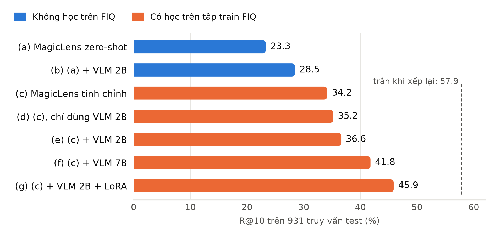

# Kết quả: bài báo và dự án

Tài liệu này gồm ba phần:

1. **Kết quả của bài báo** [*MagicLens*](https://arxiv.org/abs/2403.19651) (ICML 2024), trích từ các bảng trong bài.
2. **Kết quả dự án đã có**: phần tái hiện benchmark và các thí nghiệm cải tiến trên FashionIQ dress.
3. **Lưu ý khi đặt hai phần cạnh nhau**, vì giao thức đánh giá của chúng khác nhau.

Cập nhật ngày 16/11/2026. Cách chạy lại từng benchmark nằm ở [tai_hien_benchmark.md](tai_hien_benchmark.md).

## 1. Kết quả của bài báo

Mọi số trong mục này là **zero-shot**: mô hình không được huấn luyện trên dữ liệu của benchmark. Repo chỉ công bố checkpoint của các bản **CLIP**. Các bản CoCa tốt hơn nhưng không có checkpoint.

### 1.1. Năm benchmark truy xuất từ (ảnh, chỉ dẫn) ra ảnh (Bảng 1)

| Phương pháp | Backbone | Tham số | FIQ R@10 | CIRR R@1 | CIRR Rs@1 | CIRCO mAP@5 | DTIN R@10 | GeneCIS Rs@1 |
|---|---|---|---|---|---|---|---|---|
| PALAVRA | CLIP-B | 176M | 19.8 | 16.6 | 41.6 | 4.6 | – | – |
| SEARLE | CLIP-B | 165M | 22.9 | 24.0 | 54.9 | 9.4 | – | – |
| CIReVL | CLIP-B | 12.3B¹ | 28.3 | 23.9 | 60.2 | 14.9 | – | 15.9 |
| PLI | BLIP-B | 224M² | 35.9 | 27.2 | 55.1 | 7.1 | – | – |
| **MagicLens-B** | **CLIP-B** | **166M** | **26.3** | **27.0** | **66.7** | **23.1** | **28.3** | **15.0** |
| **MagicLens-B** | **CoCa-B** | **267M** | **35.2** | **31.6** | **69.3** | **30.8** | **46.8** | **17.4** |
| Pic2Word | CLIP-L | 429M | 24.7 | 23.9 | – | 8.7 | 10.1 | 11.2 |
| SEARLE | CLIP-L | 442M | 25.6 | 24.2 | 53.8 | 11.7 | – | 12.3 |
| Context-I2W | CLIP-L | 496M | 27.8 | 25.6 | – | – | 12.9 | – |
| CompoDiff | CLIP-L | 568M | 36.0 | 18.2 | 57.4 | 12.6 | – | 14.9 |
| CIReVL | CLIP-L | 12.5B¹ | 28.6 | 24.6 | 59.5 | 18.6 | – | 15.9 |
| PLI | CLIP-L | 428M² | 35.4 | 25.5 | 55.6 | 10.4 | – | – |
| LinCIR | CLIP-L | 442M | 26.3 | 25.0 | 57.1 | 12.6 | – | 12.2 |
| **MagicLens-L** | **CLIP-L** | **465M** | **30.7** | **30.1** | **68.1** | **29.6** | **41.5** | **16.3** |
| **MagicLens-L** | **CoCa-L** | **613M** | **38.0** | **33.3** | **70.9** | **34.1** | **48.2** | **16.7** |

¹ CIReVL dùng nhiều mô hình, trong đó có ChatGPT. Bài báo chỉ đếm các thành phần đã biết kích thước.
² PLI không công bố mã nên bài báo ước lượng.

Đọc bảng:
- **CIRCO và DTIN:** bản nhỏ nhất, MagicLens-B CLIP (166M tham số), đã vượt mọi phương pháp khác trong Bảng 1. Ví dụ CIRCO mAP@5 là 23.1, so với 18.6 của phương pháp khác tốt nhất trong bảng.
- **FIQ:** đây là benchmark mà các bản CLIP không dẫn đầu. PLI (35.9) và CompoDiff (36.0) cao hơn MagicLens-L CLIP (30.7). Chỉ MagicLens-L CoCa (38.0) đứng đầu Bảng 1. Bảng 12 còn có LinCIR với backbone CLIP-G, đạt 45.1.
- **CIRR R@1 và GeneCIS:** MagicLens-B CLIP xấp xỉ hoặc thấp hơn phương pháp tốt nhất cùng cỡ: 27.0 so với 27.2 của PLI, và 15.0 so với 15.9 của CIReVL.
- **Câu "nhỏ hơn 50 lần" trong tóm tắt** nói về MagicLens-B **CoCa** (267M) so với CIReVL (từ 12.3B tham số) trên GeneCIS, CIRCO và DTIN (Hình 7).

### 1.2. FashionIQ theo danh mục (Bảng 12, R@10 / R@50)

Bảng 12 đầy đủ có 22 dòng, kể cả các backbone rất lớn (CLIP-H, CLIP-G). Dưới đây là:
- bốn bản MagicLens;
- các phương pháp dùng backbone cỡ B hoặc L có R@10 trung bình cao hơn MagicLens-L CLIP;
- phương pháp tốt nhất của bảng.

| Phương pháp | Backbone | dress | shirt | toptee | Trung bình |
|---|---|---|---|---|---|
| **MagicLens-B** | **CLIP-B** | **21.5 / 41.3** | **27.3 / 48.8** | **30.2 / 52.3** | **26.3 / 47.4** |
| MagicLens-B | CoCa-B | 29.0 / 48.9 | 36.5 / 55.5 | 40.2 / 61.9 | 35.2 / 55.4 |
| **MagicLens-L** | **CLIP-L** | **25.5 / 46.1** | **32.7 / 53.8** | **34.0 / 57.7** | **30.7 / 52.5** |
| MagicLens-L | CoCa-L | 32.3 / 52.7 | 40.5 / 59.2 | 41.4 / 63.0 | 38.0 / 58.2 |
| PLI | BLIP-B | 28.6 / 50.8 | 38.1 / 57.8 | 40.9 / 62.7 | 35.9 / 57.1 |
| PLI | CLIP-L | 28.1 / 51.1 | 38.6 / 58.5 | 39.4 / 62.7 | 35.4 / 57.4 |
| CompoDiff | CLIP-L | 32.2 / 46.3 | 37.7 / 49.1 | 38.1 / 50.6 | 36.0 / 48.6 |
| LinCIR | CLIP-G (2.6B) | 38.1 / 60.9 | 46.8 / 65.1 | 50.5 / 71.1 | 45.1 / 65.7 |

Dòng in đậm là các bản có checkpoint công bố. Ở mọi dòng của Bảng 12, dress là danh mục có R@10 thấp nhất.

### 1.3. CIRCO (Bảng 14 và README, mAP@K)

| Mô hình | mAP@5 | mAP@10 | mAP@25 | mAP@50 |
|---|---|---|---|---|
| MagicLens-B CLIP, bài báo | 23.1 | 23.8 | 25.8 | 26.7 |
| MagicLens-B CLIP, checkpoint chuyển đổi | 22.3 | 23.2 | 25.0 | 26.0 |
| MagicLens-B CoCa | 30.8 | 32.0 | 34.5 | 35.6 |
| MagicLens-L CLIP, bài báo | 29.6 | 30.8 | 33.4 | 34.4 |
| MagicLens-L CLIP, checkpoint chuyển đổi | 29.5 | 30.8 | 33.2 | 34.3 |
| MagicLens-L CoCa | 34.1 | 35.4 | 38.1 | 39.2 |
| CIReVL, CLIP-G (phương pháp khác tốt nhất) | 26.8 | 27.6 | 30.0 | 31.0 |

Checkpoint công bố là bản đã chuyển đổi định dạng. Khi tái hiện, mốc để so là dòng "checkpoint chuyển đổi".

CIReVL với backbone CLIP-G (14.6B tham số) không có trong Bảng 1. Phương pháp này cao hơn MagicLens-B CLIP nhưng thấp hơn MagicLens-L CLIP.

### 1.4. DTIN (Bảng 15, R@10 / R@50)

| Mô hình | cartoon | origami | toy | sculpture | Trung bình |
|---|---|---|---|---|---|
| **MagicLens-B CLIP** | **49.4 / 67.0** | **13.8 / 26.3** | **25.8 / 43.4** | **24.3 / 41.3** | **28.3 / 44.5** |
| MagicLens-B CoCa | 65.8 / 73.3 | 29.3 / 38.6 | 46.7 / 57.7 | 45.3 / 57.1 | 46.8 / 56.7 |
| **MagicLens-L CLIP** | **62.6 / 72.2** | **21.5 / 33.4** | **43.8 / 58.4** | **38.0 / 54.2** | **41.5 / 54.5** |
| MagicLens-L CoCa | 60.1 / 69.6 | 36.0 / 44.7 | 45.2 / 56.9 | 51.4 / 59.6 | 48.2 / 57.7 |
| CIReVL, CLIP-G | 19.2 / 42.8 | 30.2 / 41.3 | 22.2 / 43.1 | 23.4 / 45.0 | 23.8 / 43.0 |
| Pic2Word, CLIP-L | 8.0 / 21.9 | 13.5 / 25.6 | 8.7 / 21.6 | 10.0 / 23.8 | 10.1 / 23.2 |

Origami là miền yếu nhất của các bản CLIP: CIReVL đạt 30.2, cao hơn cả MagicLens-L CLIP (21.5).

### 1.5. Các nhiệm vụ khác

**Ảnh phác thảo → ảnh thật** (Bảng 4). Mọi truy vấn dùng chung chỉ dẫn `"find a natural image of it"`. Các phương pháp so sánh dùng một checkpoint riêng cho mỗi benchmark; MagicLens dùng một checkpoint cho cả ba.

| Phương pháp | TU-Berlin mAP / P@100 | Sketchy mAP@200 / P@200 | QuickDraw mAP / P@200 |
|---|---|---|---|
| ViT (2021) | 36.0 / 50.3 | 40.3 / 51.2 | 10.1 / 11.3 |
| SOTA trước đó (2023) | 56.9 / 63.7 | 52.5 / 62.4 | 14.5 / 21.6 |
| **MagicLens-B CLIP** | **45.9 / 57.9** | **49.3 / 60.6** | **10.1 / 14.0** |
| MagicLens-B CoCa | 61.7 / 72.1 | 70.5 / 77.2 | 13.9 / 19.9 |
| **MagicLens-L CLIP** | **62.9 / 73.1** | **68.2 / 75.8** | **15.1 / 20.4** |
| MagicLens-L CoCa | 70.2 / 79.1 | 75.7 / 81.3 | 19.7 / 27.4 |

**Ảnh ↔ văn bản** (Bảng 3, bản CoCa). Sau khi huấn luyện MagicLens, bộ mã hóa của backbone truy xuất văn bản → ảnh tốt hơn. Ví dụ R@1 trên MSCOCO: CoCa-B 46.4 lên 48.9, CoCa-L 49.3 lên 53.1. Chiều ảnh → văn bản giảm nhẹ, ví dụ Flickr30K R@1 của CoCa-L từ 92.1 xuống 89.6.

**Đánh giá bằng người** (Bảng 9). MagicLens-L (CoCa) đối đầu LinCIR trên kho 1.4 triệu ảnh chưa thấy khi huấn luyện. Mỗi loại chỉ dẫn có 50 truy vấn viết tay, và kết quả là trung bình của ba người chấm.

| Loại chỉ dẫn | MagicLens-L thắng | LinCIR thắng | Hòa |
|---|---|---|---|
| Thị giác đơn giản | 50.7% | 41.3% | 8.0% |
| Thị giác phức tạp | 61.3% | 24.0% | 14.7% |
| Ngoài thị giác | 80.0% | 4.7% | 15.3% |

### 1.6. Ablation liên quan đến dự án (Bảng 7, 8; MagicLens-B CoCa)

| Biến thể | FIQ R@10 | CIRR R@1 | CIRCO mAP@5 | DTIN R@10 | GeneCIS |
|---|---|---|---|---|---|
| MagicLens-B CoCa | 35.2 | 31.6 | 30.8 | 46.8 | 17.4 |
| Bỏ mẫu âm là ảnh truy vấn | 33.2 | 1.6 | 11.9 | 14.1 | 14.5 |
| Cross-attention thay cho self-attention | 31.0 | 28.3 | 27.0 | 41.4 | 16.2 |
| Đóng băng backbone khi huấn luyện | 30.8 | 25.9 | 21.7 | 30.1 | 15.2 |

Hai dòng cuối liên quan trực tiếp đến dự án:
- **Bỏ mẫu âm là ảnh truy vấn:** bước tinh chỉnh của dự án vẫn giữ loại mẫu âm này.
- **Đóng băng backbone:** bước tinh chỉnh của dự án đóng băng backbone. Hướng 2 của tài liệu đề xuất là mở băng backbone.

## 2. Kết quả hiện có của dự án

Mọi kết quả trong mục này dùng **MagicLens-B CLIP** với checkpoint chuyển đổi, và mới chỉ có trên **FashionIQ dress**.

### 2.1. Tái hiện benchmark của bài báo

| Benchmark | Mô hình | Bài báo | Dự án | Ghi chú |
|---|---|---|---|---|
| FIQ dress, R@10 / R@50 | Base | 21.5 / 41.3 | 21.8 / 43.4 | Bộ dữ liệu của dự án cũ thiếu 4.3% ảnh: còn 1861 truy vấn và kho 3653 ảnh |
| FIQ shirt | Base | 27.3 / 48.8 | chưa có | |
| FIQ toptee | Base | 30.2 / 52.3 | chưa có | |
| FIQ, trung bình 3 danh mục | Base | 26.3 / 47.4 | chưa có | |
| DTIN, trung bình 4 miền | Base | 28.3 / 44.5 | chưa có | |
| CIRCO mAP@5 | Base | 22.3 (chuyển đổi) | chưa có | Chấm trên máy chủ CIRCO |
| FIQ, trung bình 3 danh mục | Large | 30.7 / 52.5 | chưa có | |
| DTIN, trung bình 4 miền | Large | 41.5 / 54.5 | chưa có | |
| CIRCO mAP@5 | Large | 29.5 (chuyển đổi) | chưa có | |

Trên FIQ dress, R@10 lệch 0.3 điểm so với bài báo, nên pipeline đánh giá chạy đúng. R@50 cao hơn 2.1 điểm. Một nguyên nhân có thể là kho ảnh nhỏ hơn do thiếu ảnh.

### 2.2. Thí nghiệm cải tiến trên FIQ dress

Cách đánh giá chung:
- **Kho ảnh:** 3653 ảnh dress của tập val.
- **Truy vấn:** 1861 truy vấn, chia ngẫu nhiên (seed 0) thành dev 930 và test 931.
- **Chọn cấu hình:** mọi lựa chọn (mẫu câu, tham số trộn, tốc độ học, epoch) chỉ dựa trên R_avg = (R@10 + R@50) / 2 của dev.
- **Báo cáo:** số trên test, kèm khoảng tin cậy 95% của chênh lệch so với zero-shot (bootstrap ghép cặp 2000 lần).

| Cấu hình | Học trên FIQ | R@1 | R@5 | R@10 | R@50 | ΔR@10 so với (a) |
|---|---|---|---|---|---|---|
| (a) MagicLens zero-shot | Không | 8.1 | 17.8 | 23.3 | 42.1 | |
| Thủ thuật không huấn luyện tốt nhất trên dev³ | Không | 7.3 | 17.1 | 23.5 | 43.0 | +0.2 [−1.1, +1.6] |
| Chỉ VLM, rerank top-50 | Không | 8.1 | 19.3 | 24.9 | 42.1 | +1.6 [−0.9, +4.2] |
| (b) MagicLens + VLM, rerank top-50 (w = 3) | Không⁴ | 10.8 | 21.7 | 28.5 | 42.1 | **+5.2 [+3.0, +7.2]** |
| (c) Tinh chỉnh khối hợp nhất | Có | 11.5 | 25.7 | 34.2 | 57.9 | **+10.8 [+8.3, +13.3]** |
| (d) (c), xếp lại top-20 chỉ theo VLM | Có | 10.7 | 25.3 | 35.2 | 57.9 | +11.9 [+9.1, +14.6] |
| (e) (c) + MagicLens + VLM, top-50 (w = 1.5) (Hướng 1) | Có | 15.1 | 29.8 | 36.6 | 57.9 | **+13.3 [+10.7, +16.0]** |
| (f) như (e), VLM 7B thay cho 2B (w = 2) (Hướng 3) | Có | **19.1** | 34.2 | 41.8 | 57.9 | **+18.5 [+15.5, +21.3]** |
| (g) như (e), VLM 2B + LoRA (w = 2) (Hướng 3) | Có⁵ | 18.9 | **37.2** | **45.9** | 57.9 | **+22.6 [+19.4, +25.7]** |

³ Mẫu câu "{c2} and {c1}" kết hợp rerank top-100 bằng điểm CLIP ảnh–ảnh và văn bản–ảnh (λ = 0.6, μ = 0.3).
⁴ Nhãn của nửa dev chỉ được dùng để chọn k và w.
⁵ Cả MagicLens lẫn VLM đều học trên tập train của FashionIQ dress; VLM được tinh chỉnh LoRA.

Khoảng tin cậy chứa 0 nghĩa là chênh lệch không có ý nghĩa thống kê.
- Hai cải tiến có ý nghĩa là rerank bằng VLM khi trộn với điểm MagicLens, và tinh chỉnh.
- Ghép cả hai cho (e): R@10 36.6, R@1 15.1.
- Thay VLM bằng bản mạnh hơn (Hướng 3) tăng tiếp: 7B cho R@10 41.8, còn 2B + LoRA cho 45.9, cao nhất. So với (e), (g) hơn +9.2 [+6.9, +11.5].
- Mức tăng của (d) so với (a) chủ yếu đến từ tinh chỉnh: so với (c), (d) chỉ hơn +1.1 [−1.1, +3.1].

Biểu đồ được vẽ bằng `python docs/src/ve_bieu_do_ket_qua.py`. Đường đứt nét là R@50 của (c), tức mức trần khi xếp lại top-50 của (c).

Chi tiết từng thí nghiệm. Bảng đầy đủ nằm trong `output/`.

- **Tiền xử lý ảnh** ([output/fiq-dress-base_experiments.md](../output/fiq-dress-base_experiments.md)). Cắt vùng vuông làm R@10 giảm xuống 21.1. Thêm viền (pad) cho 23.1, ngang cách gốc. Vì vậy các thí nghiệm sau giữ cách gốc.
- **Cách viết truy vấn:** không mẫu câu nào hơn "{c1} and {c2}" trên test. Mẫu "swap" tốt nhất trên dev (R_avg 33.0) nhưng R@10 test chỉ 22.8. Gộp bốn mẫu câu cho 22.2.
- **Rerank top-100 bằng điểm CLIP:** +0.2, không có ý nghĩa thống kê. Ảnh đích nằm trong top-100 ở 51.8% truy vấn test, nên đó là trần của cách rerank này.
- **Rerank top-50 bằng VLM Qwen2-VL-2B** ([output/fiq-dress-base_vlm_rerank.md](../output/fiq-dress-base_vlm_rerank.md)):
  - VLM một mình không hơn đáng kể (+1.6), nhưng trộn với điểm MagicLens thì được +5.2.
  - **Khả năng tách ảnh đích khỏi các ứng viên khác** (AUC, trên 392 truy vấn test có ảnh đích trong top-50): MagicLens 0.739, VLM 0.781, trộn 0.812.
  - Tương quan giữa hai điểm chỉ 0.15, nên hai điểm bổ sung cho nhau.
  - Trên test, ảnh đích được đưa vào top-10 ở 77 truy vấn và bị đẩy ra ở 29 truy vấn.
  - Chi phí: 2.3 giờ GPU T4 cho 93 050 cặp, tức 89 ms/cặp.
- **Tinh chỉnh khối hợp nhất** ([output/fiq-dress-base_finetune.md](../output/fiq-dress-base_finetune.md)):
  - Backbone CLIP đóng băng; học 16.8M tham số trên 5441 truy vấn train.
  - Đã thử ba tốc độ học 1e-5, 3e-5 và 1e-4, mỗi tốc độ 15 epoch. Chọn 1e-5 ở epoch 14 (dev R_avg 45.3). Với 1e-4, dev R_avg không vượt quá 40.2.
  - Cả ba lần thử mất 35.2 phút trên CPU.
  - R@50 tăng từ 42.1 lên 57.9, nên trần cho bước rerank phía sau cũng cao hơn.
- **Hướng 1, ghép (c) với rerank VLM** ([huong1_tinh_chinh_rerank.md](huong1_tinh_chinh_rerank.md), mục 5; [output/huong1/huong1_tong_hop.md](../output/huong1/huong1_tong_hop.md)):
  - Rerank vẫn có ích khi bước 1 đã tinh chỉnh: (e) − (c) = +2.5 [+0.5, +4.4] R@10. Mức tăng này chỉ bằng khoảng một nửa so với khi bước 1 là zero-shot. Hiệu giữa hai mức tăng là −2.7 [−5.3, −0.2], nên hai cải tiến chồng lấn một phần.
  - Rerank tác dụng mạnh nhất ở đầu danh sách: R@1 tăng từ 11.4 lên 15.1.
  - Trên ứng viên của bản tinh chỉnh, VLM tách ảnh đích kém hơn MagicLens (AUC 0.736 so với 0.761). Tương quan giữa hai điểm vẫn thấp (0.17), nên trộn vẫn có lợi (AUC 0.796).
  - Chấm 93 050 cặp mất 0.9 giờ GPU.
- **Hướng 3, reranker mạnh hơn trên cùng ứng viên của (c)** ([huong3_reranker_manh_hon.md](huong3_reranker_manh_hon.md), mục 5; [output/huong3/huong3_tong_hop.md](../output/huong3/huong3_tong_hop.md)):
  - Cả hai VLM mạnh hơn đều cải thiện rõ so với (e): 7B +5.2 [+3.1, +7.1], 2B + LoRA +9.2 [+6.9, +11.5] R@10. 2B + LoRA hơn cả 7B: +4.1 [+2.0, +6.1] R@10, nhưng R@1 của hai bản ngang nhau (18.9 và 19.1).
  - VLM nay tách ảnh đích tốt hơn MagicLens: AUC 0.813 (7B) và 0.841 (LoRA), so với 0.761. Trộn vẫn có lợi: AUC 0.838 và 0.870.
  - Mức tăng chủ yếu đến từ việc kéo ảnh đích ở hạng sâu lên. Trong các truy vấn có ảnh đích ở hạng 31–50 của bước 1, LoRA đưa được 41.8% vào top-10. Tỉ lệ này của 2B là 13.4%, của 7B là 20.9%.
  - LoRA được dạy loại ảnh truy vấn. Tuy vậy, lọc ảnh truy vấn khỏi mọi kết quả không làm R@10 thay đổi, nên đó không phải nguồn gốc của mức tăng.
  - LoRA học 2 epoch trong 51 phút. AUC dev tăng từ 0.730 lên 0.789.
  - Đổi sang bfloat16 không làm VLM tốt lên. Trên 200 truy vấn, AUC đổi −0.001, còn đổi sang 7B tăng +0.066.

### 2.3. Kết quả đang chờ

| Việc | Trạng thái | Cần gì để điền vào mục 2.1 / 2.2 |
|---|---|---|
| FIQ đủ ba danh mục (notebook `01_fiq`) | Đã chạy trên Colab | Thư mục `MyDrive/magiclens/ket_qua/fiq/` và tên GPU đã dùng |
| DTIN (notebook `02_dtin`) | Chưa chạy | Ảnh ImageNet val (tải bằng `wget` trên Colab) |
| CIRCO (notebook `03_circo`) | Chưa chạy | Điểm mAP do máy chủ CIRCO trả về sau khi nộp tệp kết quả |
## 3. Lưu ý khi so sánh với bài báo

- **Không so số ở mục 2.2 với Bảng 1 hay Bảng 12.** Mục 2.2 đo trên 931 truy vấn test của riêng dress, với kho thiếu 4.3% ảnh. Mốc đúng để so là dòng (a), 23.3, đo trên cùng tập truy vấn. Số "FIQ" của bài báo là trung bình ba danh mục trên toàn bộ tập val.
- **Bản tinh chỉnh (c) không còn là zero-shot**, vì nó đã học trên tập train của FashionIQ. Mọi số của bài báo là zero-shot. Vì vậy không nên viết rằng 34.2 "vượt MagicLens-L CoCa (32.3 trên dress)": hai số khác cả giao thức lẫn tập truy vấn.
- **Rerank bằng VLM (b) gần như zero-shot.** VLM không được huấn luyện thêm; dự án chỉ chọn hai tham số k và w trên nửa dev.
- **(g) học trên FashionIQ ở cả hai bước.** MagicLens đã được tinh chỉnh, và VLM cũng được tinh chỉnh LoRA trên cùng tập train. Vì vậy (g) càng không so được với số zero-shot của bài báo.
- **(e) chạy ở float16, còn (f) và (g) chạy ở bfloat16.** Phép kiểm tra trên 200 truy vấn cho thấy riêng kiểu số không làm VLM tốt lên. Xem [huong3_reranker_manh_hon.md](huong3_reranker_manh_hon.md), mục 5.3.
- **R@1 của (c) có hai giá trị, 11.5 và 11.4.** Bước tinh chỉnh tính bằng JAX cho 11.5; bước xuất top-50 tính lại bằng NumPy cho 11.4. Ở một truy vấn, hai ảnh có điểm chỉ chênh 1.2 × 10⁻⁷ nên đổi chỗ. R@5, R@10 và R@50 không đổi. Xem [huong1_tinh_chinh_rerank.md](huong1_tinh_chinh_rerank.md), bước 2.
