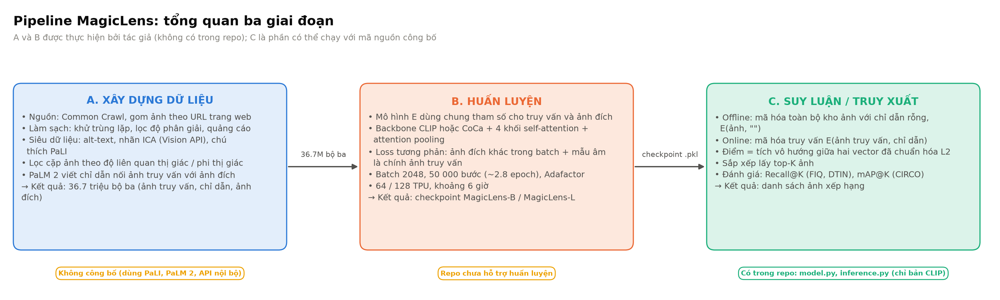
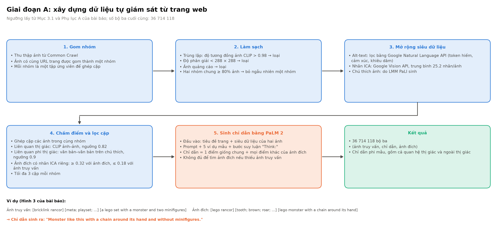
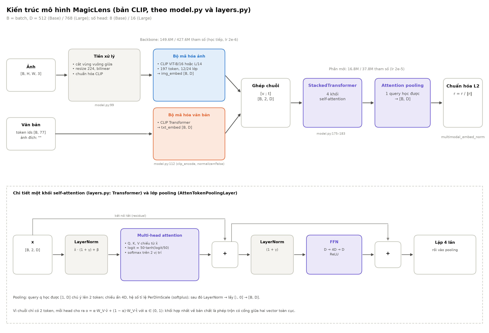
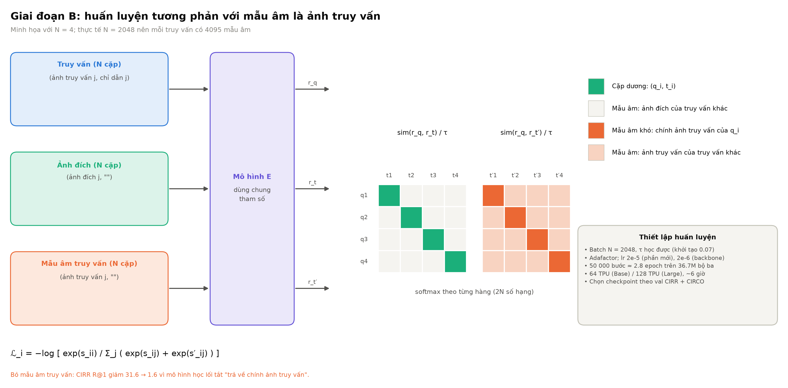
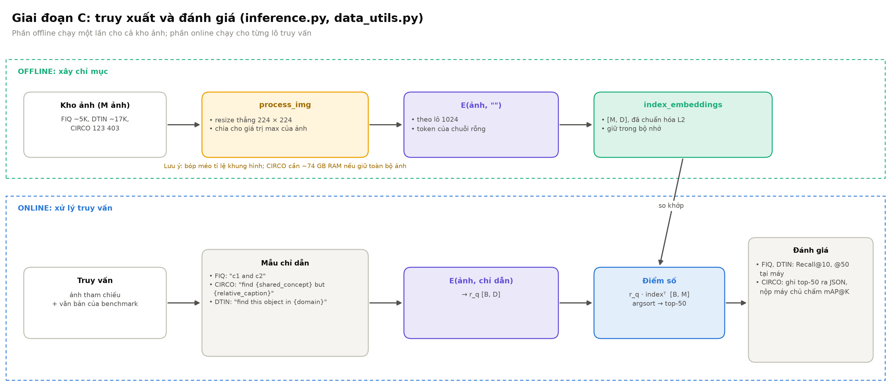

# Kiến trúc pipeline MagicLens

Tài liệu này mô tả pipeline của MagicLens theo bài báo [*MagicLens: Self-Supervised Image Retrieval with Open-Ended Instructions*](https://arxiv.org/abs/2403.19651) (ICML 2024) và mã nguồn trong thư mục [`magiclens/`](../).

Pipeline có ba giai đoạn. **A** (xây dựng dữ liệu) và **B** (huấn luyện) do các tác giả thực hiện bằng hạ tầng nội bộ của Google và không có trong repo. **C** (suy luận và đánh giá) là phần chạy được với mã nguồn và checkpoint CLIP đã công bố.



## A. Xây dựng dữ liệu



| Bước | Việc làm | Ngưỡng / công cụ |
|---|---|---|
| 1. Gom nhóm | Gom các ảnh cùng URL trang trong Common Crawl thành một nhóm | — |
| 2. Làm sạch | Khử trùng lặp, lọc độ phân giải, ảnh quảng cáo, nhóm trùng lặp | CLIP > 0.98; ≥ 288 × 288; nhóm chung ≥ 80% |
| 3. Mở rộng siêu dữ liệu | Gắn alt-text, nhãn ICA và chú thích cho mỗi ảnh | Google NL API, Google Vision API, PaLI |
| 4. Chấm điểm và lọc cặp | Ghép cặp trong nhóm, giữ cặp liên quan thị giác hoặc phi thị giác | CLIP ảnh–ảnh 0.82; văn bản–văn bản 0.9; ICA riêng ≥ 0.32 / ≤ 0.18; tối đa 3 cặp/nhóm |
| 5. Sinh chỉ dẫn | PaLM 2 đọc siêu dữ liệu của hai ảnh và viết chỉ dẫn | Prompt + 5 ví dụ mẫu + bước suy luận "Think:" |

Kết quả: **36 714 118 bộ ba** (ảnh truy vấn, chỉ dẫn, ảnh đích). LLM không nhìn thấy ảnh mà chỉ đọc siêu dữ liệu dạng văn bản.

## B. Mô hình và huấn luyện

### Kiến trúc mô hình



Cùng một mạng `E` (dùng chung tham số) mã hóa cả truy vấn `(ảnh, chỉ dẫn)` lẫn ảnh đích `(ảnh, "")`:

1. **Tiền xử lý ảnh:** cắt vùng vuông ở giữa, resize 224 × 224, chuẩn hóa theo CLIP ([model.py:99](../model.py#L99)).
2. **Backbone CLIP:** mã hóa ảnh và văn bản thành hai vector `v`, `t` ∈ ℝᴰ, chưa chuẩn hóa ([model.py:112](../model.py#L112)).
3. **Ghép chuỗi** `[v ; t]` có kích thước `[B, 2, D]` ([model.py:175](../model.py#L175)).
4. **4 khối self-attention** kiểu Pre-LN, FFN 4D, có kết nối tắt (`StackedTransformer` trong [layers.py](../layers.py)).
5. **Attention pooling** với 1 vector truy vấn học được, rồi **chuẩn hóa L2**.

| Cấu hình | D | Số head | Backbone | Phần mới thêm | Tổng |
|---|---|---|---|---|---|
| Base (ViT-B/16) | 512 | 8 | 149.6M | 16.8M | 166.4M |
| Large (ViT-L/14) | 768 | 16 | 427.6M | 37.8M | 465.4M |

Chuỗi đầu vào của khối hợp nhất chỉ có **2 token**, nên mỗi head attention là một phép trộn có cổng giữa vector ảnh và vector văn bản. Mọi chi tiết cần cho chỉ dẫn phải nằm sẵn trong vector toàn cục của backbone.

### Huấn luyện (không có trong repo)



Hàm mất mát cho truy vấn thứ `i` trong batch `N` bộ ba:

```
L_i = -log( exp(s_ii) / Σ_j [ exp(s_ij) + exp(s'_ij) ] )
```

- `s_ij` = cos(r_q của truy vấn i, r_t của ảnh đích j) / τ
- `s'_ij` = cos(r_q của truy vấn i, E(ảnh truy vấn j, "")) / τ, tức **mẫu âm truy vấn**

Mẫu âm truy vấn ngăn mô hình học lối tắt "trả về chính ảnh truy vấn". Nếu bỏ nó, CIRR R@1 giảm từ 31.6 xuống 1.6.

Thiết lập: batch 2048 (mỗi truy vấn có 4095 mẫu âm), τ học được (khởi tạo 0.07), Adafactor, lr 2e-5 cho phần mới và 2e-6 cho backbone, 50 000 bước (khoảng 2.8 epoch), 64/128 TPU trong khoảng 6 giờ.

## C. Suy luận và đánh giá



**Offline:** mã hóa toàn bộ kho ảnh với chuỗi rỗng, `E(ảnh, "")`, theo lô 1024, được `index_embeddings` có kích thước `[M, D]`.

**Online:** ghép câu chỉ dẫn theo mẫu của từng benchmark, mã hóa `E(ảnh, chỉ dẫn)`, nhân với chỉ mục ([inference.py:127](../inference.py#L127)), rồi sắp xếp lấy top-50 ([inference.py:129](../inference.py#L129)).

| Benchmark | Mẫu chỉ dẫn trong mã | Đánh giá |
|---|---|---|
| FIQ | `"<mô tả 1> and <mô tả 2>"` | Recall@10, @50 tại máy |
| CIRCO | `"find {shared_concept} but {relative_caption}"` | Ghi top-50 ra JSON, nộp máy chủ chấm mAP@K |
| DTIN | `"find this object in {domain}"` ([data_utils.py:218](../data_utils.py#L218)) | Recall@10, @50 tại máy |

Lưu ý khi chạy:
- `process_img` ([data_utils.py:97](../data_utils.py#L97)) resize thẳng về 224 × 224 nên bóp méo tỉ lệ khung hình. Vì ảnh đã vuông, bước cắt vùng vuông trong mô hình không còn tác dụng.
- Toàn bộ ảnh được giữ trong RAM: CIRCO (123 403 ảnh) cần khoảng 74 GB.

## Vẽ lại sơ đồ

Các hình trong `images/` được sinh từ [`src/ve_so_do.py`](src/ve_so_do.py). Muốn chỉnh nội dung hay bố cục thì sửa script rồi chạy lại (cần `matplotlib`):

```bash
python docs/src/ve_so_do.py docs/images
```
